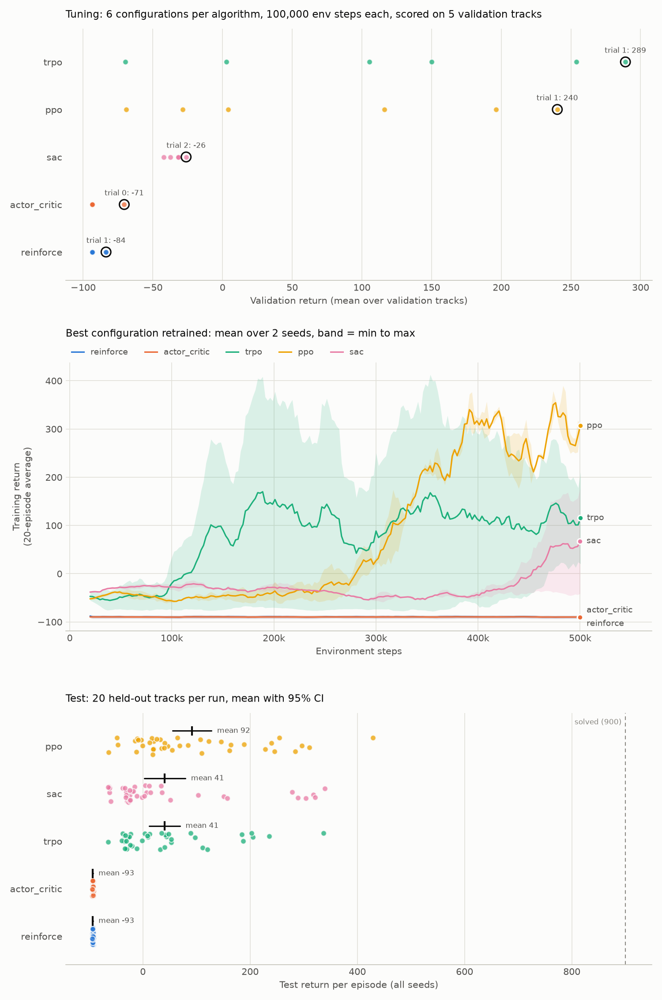

# Policy Optimization from Scratch

This repository implements policy-gradient reinforcement-learning algorithms in PyTorch and compares them on the continuous-control **CarRacing-v3** environment from Gymnasium. The agent receives 96×96 RGB frames and predicts continuous steering, gas, and brake actions.

## 1. Introduction

Policy-gradient methods optimize a parameterized policy directly by adjusting its parameters to maximize the expected cumulative reward. For a stochastic policy \(\pi_\theta(a\mid s)\), the objective is commonly written as

\[
J(\theta)=\mathbb{E}_{\tau\sim\pi_\theta}
\left[\sum_{t=0}^{T}\gamma^t r_t\right],
\]

where \(\tau\) denotes a trajectory generated by the policy and \(\gamma\) is the discount factor.

Although the objective is straightforward, implementing policy-gradient methods raises three important questions:

1. **Gradient estimation:** How can we obtain a useful learning signal from sampled trajectories while controlling its variance?
2. **Policy updates:** How can we improve the policy without making updates so large that training becomes unstable?
3. **Data efficiency:** How can we make better use of collected experience instead of discarding it after a single update?

This repository explores several algorithms that address these challenges, following the conceptual progression in the [reference article](https://sreejithb.com/rl-policy-gradient/single.html), with Soft Actor-Critic (SAC) included as an off-policy alternative.

| Algorithm | Core idea | What it addresses | Advantages | Limitations |
|---|---|---|---|---|
| **REINFORCE** | Uses sampled returns to weight the log-probability gradients of the actions taken. | Establishes the basic Monte Carlo policy-gradient estimator. | Simple and provides an unbiased gradient estimate under standard assumptions. Naturally supports stochastic policies and continuous actions. | High variance; typically requires complete trajectories before updating; does not reuse collected samples. |
| **Baseline and Advantage** | Subtracts a state-dependent baseline, usually the value function \(V(s)\), from the return to obtain an advantage estimate. | Reduces gradient variance by measuring whether an action performed better or worse than expected, rather than using the raw return alone. | Preserves the expected policy gradient while providing a more informative learning signal. | The value baseline is not known in advance and must be estimated. |
| **Actor–Critic** | Learns a value function with a critic and uses its estimates to guide policy updates by the actor. | Makes the baseline practical to use and enables bootstrapped, step-by-step learning instead of relying exclusively on complete episode returns. | More frequent feedback and potentially lower-variance gradient estimates. | Critic estimation errors can introduce bias into the learning signal; training the actor and critic together adds complexity. |
| **TRPO** | Maximizes a surrogate policy objective while constraining the KL divergence between the old and new policies. | Controls the size of policy updates to avoid destructive changes during training. | Provides a principled trust-region constraint and strong policy-update stability under its theoretical assumptions. | Computationally expensive and more difficult to implement due to conjugate-gradient optimization and line search. |
| **PPO** | Uses a clipped probability-ratio objective to discourage excessively large policy updates. | Retains the idea of conservative policy updates while avoiding TRPO's expensive constrained optimization. | Uses standard first-order optimization, supports minibatch updates, and is relatively straightforward to implement. | Clipping does not enforce a strict trust-region constraint; performance can remain sensitive to hyperparameters. |
| **SAC** | Optimizes an entropy-regularized objective using an off-policy actor–critic framework and experience replay. | Addresses the limited sample reuse of on-policy policy-gradient methods while encouraging stochastic exploration. | Reuses past transitions, promotes exploration, and is well suited to continuous-control tasks. | Requires additional components, including critics, target networks, and a replay buffer; introduces more hyperparameters and implementation complexity. |

The progression from REINFORCE to PPO illustrates how policy-gradient methods improve their learning signals and control policy updates: REINFORCE starts with sampled returns, baselines introduce the advantage perspective, actor–critic learns the baseline, TRPO constrains policy changes, and PPO approximates this constraint with a simpler clipped objective.

SAC explores a different direction. Rather than following the on-policy progression, it combines policy optimization with off-policy learning and entropy regularization, allowing experience to be reused across multiple updates.

Together, these algorithms provide a practical comparison of different design choices in policy optimization, from basic Monte Carlo gradient estimation to more advanced approaches for stable and sample-efficient continuous control.

## 2. How to run

Use Python with the dependencies listed in `requirements.txt` (including Gymnasium's Box2D support).

```bash
python -m venv .venv
source .venv/bin/activate
python -m pip install --upgrade pip
python -m pip install -r requirements.txt
```

Train one algorithm; valid names are `reinforce`, `actor_critic`, `trpo`, `ppo`, and `sac`:

```bash
python src/training/train.py --algo ppo --max-steps 500000
```

The training script saves checkpoints under `checkpoints/` and TensorBoard logs under `runs/`. For example, view the logs with:

```bash
tensorboard --logdir runs
```

After training checkpoints, evaluate and compare the available algorithms on shared tracks:

```bash
python src/evaluation/compare.py --episodes 20
```

Run the full tuning, retraining, and reporting pipeline with:

```bash
python src/pipeline.py --name rerun --final-seeds 2
```

The full pipeline takes many hours. Use `python src/pipeline.py --quick --name quick` for a short end-to-end smoke run.

## 3. Experiment report

The saved experiment used six configurations per algorithm, each trained for 100,000 environment steps and scored on five validation tracks. The selected configuration was retrained for 500,000 steps over two seeds, then evaluated on 20 held-out tracks per seed (40 episodes per algorithm). CarRacing is considered solved at a return of 900 or higher.

| Algorithm | Mean return (95% CI) | Median | Positive returns | Solved rate |
|---|---:|---:|---:|---:|
| **PPO** | **91.911 ± 36.216** | 43.581 | 77.5% | 0% |
| SAC | 40.890 ± 38.575 | -16.939 | 42.5% | 0% |
| TRPO | 40.592 ± 28.680 | 8.997 | 55.0% | 0% |
| Actor–critic | -93.221 ± 0.178 | -93.288 | 0% | 0% |
| REINFORCE | -93.221 ± 0.178 | -93.288 | 0% | 0% |

PPO had the highest mean test return in this run. None of the algorithms reached the 900-point solved threshold. These are results from one experiment configuration; the confidence intervals and per-episode values are included for context.



The summary figure is kept in the repository; raw CSVs, settings, checkpoints, and training logs under `experiments/` remain local and are ignored by Git.

## 4. Reference

- [Policy-gradient article by Sreejith B.](https://sreejithb.com/rl-policy-gradient/single.html)
